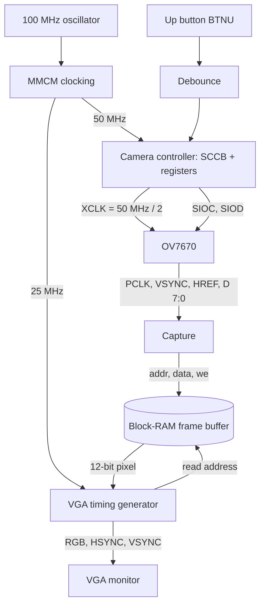
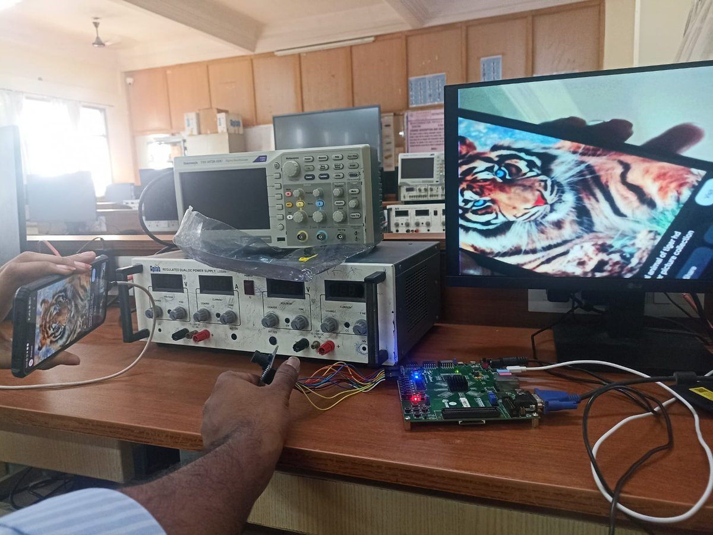
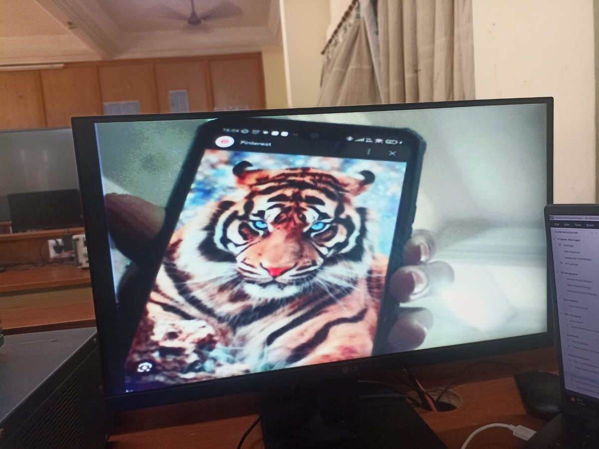

# OV7670 Camera to VGA on the Xilinx ZedBoard (Zynq-7000)


-orange.svg)


A Verilog design that captures live video from an **OV7670 camera** and shows it on a **VGA monitor**, using only the programmable logic (PL) of the ZedBoard. The camera setup, pixel capture, frame buffering and VGA output are all custom RTL. No software runs on the board.

> The Zynq processing system (PS7) is instantiated only to satisfy the Zynq design-rule check. It takes no part in the video path.

---

## Table of Contents
1. [Overview](#1-overview)
2. [Features](#2-features)
3. [Architecture](#3-architecture)
4. [Repository Structure](#4-repository-structure)
5. [Hardware Required](#5-hardware-required)
6. [Pin Mapping and Wiring](#6-pin-mapping-and-wiring)
7. [Clocking and Timing Constraints](#7-clocking-and-timing-constraints)
8. [Build and Run](#8-build-and-run)
9. [Camera Configuration](#9-camera-configuration)
10. [Results](#10-results)
11. [Troubleshooting](#11-troubleshooting)
12. [Known Limitations](#12-known-limitations)
13. [Future Work](#13-future-work)
14. [License](#14-license)

---

## Quick Start

1. Create a Vivado project for `xc7z020clg484-1`, add `rtl/*.v` and `constraints/zedboard_ov7670.xdc`, and set `ov7670_top` as the top module.
2. Generate the two IPs: `blk_mem_gen_0` (frame buffer) and `ps7_bd` (PS7 placeholder). See [Section 8](#8-build-and-run).
3. Wire the camera to PMOD JA and JB ([Section 6](#6-pin-mapping-and-wiring)), using short jumper wires.
4. Build the bitstream, program the board over JTAG, and connect a VGA monitor.
5. If the picture is blank, hold the **up button (BTNU)** for about half a second to resend the camera configuration.

---

## 1. Overview

| Stage | Input | Output |
|:--|:--|:--|
| Camera setup | Register table (77 writes) | SCCB (I2C-compatible) writes to the OV7670 |
| Capture | 8-bit data, `PCLK`, `HREF`, `VSYNC` | 12-bit RGB444 pixel, write address, write enable |
| Frame buffer | Pixel stream on the camera clock | One 640x480 frame in dual-port block RAM |
| VGA output | Frame read at 25 MHz | `HSYNC`, `VSYNC`, 4-bit R/G/B at 640x480 @ ~59.5 Hz |

---

## 2. Features

- Pure-Verilog video pipeline, with no processor in the data path.
- SCCB master and register sequencer that configure the camera at power-up, or when the button is held.
- RGB565 to RGB444 conversion (top 4 bits of each colour).
- Dual-port block-RAM frame buffer with separate write clock (camera `PCLK`) and read clock (25 MHz VGA).
- Standard 640x480 @ 60 Hz VGA timing.
- Auto-white-balance register block, which removed the green colour cast seen with the earlier table.
- Timing constraints for both clock domains, with input delays on the camera data signals.

---

## 3. Architecture



### Modules

| Module | File | Role |
|:--|:--|:--|
| `ov7670_top` | `ov7670_top.v` | Top level. Connects all blocks, the frame buffer and the PS7 placeholder. |
| `clocking` | `clocking.v` | MMCME2_ADV: 100 MHz to 50 MHz and 25 MHz. |
| `ov7670_controller` | `ov7670_controller.v` | Joins the SCCB sender and register table, and makes `XCLK` (50 MHz / 2 = 25 MHz). |
| `ov7670_registers` | `ov7670_registers.v` | Table of 77 16-bit `{register, value}` writes, ended by `16'hFFFF`. |
| `i2c_sender` | `i2c_sender.v` | SCCB write state machine, about 50 kHz SCL. It pulses `taken` only after STOP. |
| `ov7670_capture` | `ov7670_capture.v` | Joins byte pairs into RGB444 pixels and generates the write address. |
| `vga` | `vga.v` | 800x525 timing counters, read address, blanking, RGB output. |
| `debounce` | `debounce.v` | Button filter. The button must be held about 0.34 s. |
| `blk_mem_gen_0` | generated IP | Simple dual-port RAM, 12 bits x 307,200 words. |
| `ps7_bd` | generated block design | PS7 with the ZedBoard preset (design-rule placeholder only). |

### Pixel conversion
The OV7670 sends RGB565 as two bytes per pixel: `h = {R[4:0], G[5:3]}` then `l = {G[2:0], B[4:0]}`. The stored 12-bit pixel is

```
{R4, G4, B4} = { h[7:4], h[2:0], l[7], l[4:1] }
```

The VGA module drives red from `pixel[11:8]`, green from `pixel[7:4]` and blue from `pixel[3:0]`.

---

## 4. Repository Structure

```text
ov7670-zedboard-vga/
├── rtl/
│   ├── ov7670_top.v
│   ├── vga.v
│   ├── ov7670_capture.v
│   ├── ov7670_controller.v
│   ├── ov7670_registers.v
│   ├── i2c_sender.v
│   ├── debounce.v
│   └── clocking.v
├── constraints/
│   └── zedboard_ov7670.xdc
├── docs/
│   ├── hardware-setup.jpg
│   └── vga-output.jpg
├── LICENSE
└── README.md
```

`blk_mem_gen_0` and `ps7_bd` are generated inside Vivado and are not stored in the repository. Each module lives in its own file, with one definition per file.

---

## 5. Hardware Required

| Item | Notes |
|:--|:--|
| ZedBoard (XC7Z020, `xc7z020clg484-1`) | Main board |
| OV7670 module, **non-FIFO, 18-pin** | The module must expose `PCLK` and `XCLK`. Boards with `WRST/RRST/OE/RCK` pins (AL422B FIFO) do not work with this design. |
| Jumper wires, **10 cm or shorter** | Female-to-female. Long wires ring at 25 MHz and cause shifted lines. |
| VGA cable and monitor | Video output |
| Micro-USB cable on **PROG (J17)** | JTAG programming |
| 12 V ZedBoard supply | Board power |

---

## 6. Pin Mapping and Wiring

Camera signals use PMOD **JA** and **JB**. Pin numbers match `constraints/zedboard_ov7670.xdc` and the ZedBoard user guide, so check them against your board revision.

### 6.1 Camera to PMOD JA

| OV7670 signal | FPGA pin | PMOD pin |
|:--|:--|:--|
| `PWDN` | Y11 | JA1 |
| `D0` | AA11 | JA2 |
| `D2` | Y10 | JA3 |
| `D4` | AA9 | JA4 |
| `RESET` | AB11 | JA7 |
| `D1` | AB10 | JA8 |
| `D3` | AB9 | JA9 |
| `D5` | AA8 | JA10 |

### 6.2 Camera to PMOD JB

| OV7670 signal | FPGA pin | PMOD pin |
|:--|:--|:--|
| `D6` | W12 | JB1 |
| `XCLK` | W11 | JB2 |
| `HREF` | V10 | JB3 |
| `SIOD` (SDA) | W8 | JB4 |
| `D7` | V12 | JB7 |
| `PCLK` | W10 | JB8 |
| `VSYNC` | V9 | JB9 |
| `SIOC` (SCL) | V8 | JB10 |

### 6.3 Power

- On each PMOD connector, pins 5 and 11 are GND, and pins 6 and 12 are 3.3 V.
- Connect the camera 3V3 to a PMOD 3.3 V pin and the camera GND to a PMOD GND pin.
- Run several ground wires, and place a ground wire next to `PCLK` and `XCLK`.
- `SIOD` is tri-stated and needs a pull-up. Most modules have one fitted. If yours does not, add 4.7 kOhm to 3.3 V, or as a fallback add `set_property PULLUP true [get_ports OV7670_SIOD]` to the XDC.

### 6.4 VGA, clock, button, LEDs (on-board)

| Signal | FPGA pins | Standard |
|:--|:--|:--|
| `vga_red[0..3]` | V20, U20, V19, V18 | LVCMOS33 |
| `vga_green[0..3]` | AB22, AA22, AB21, AA21 | LVCMOS33 |
| `vga_blue[0..3]` | Y21, Y20, AB20, AB19 | LVCMOS33 |
| `vga_hsync`, `vga_vsync` | AA19, Y19 | LVCMOS33 |
| `clk100` | Y9 | LVCMOS33 |
| `btn` (**up button, BTNU**) | T18 | LVTTL |
| `LED[0..7]` | T22, T21, U22, U21, V22, W22, U19, U14 | LVTTL |

`btn` is the **up** push button (BTNU), not the centre button. All "resend" actions in this document use that button.

`LED[0]` lights when the register sequence has finished. The SCCB acknowledge bit is not checked, so the LED does not prove that the camera accepted the writes. `LED[1..7]` are driven low.

---

## 7. Clocking and Timing Constraints

| Clock | Frequency | Source | Used by |
|:--|:--|:--|:--|
| `clk100` | 100 MHz | Board oscillator | MMCM input |
| `clk50` | 50 MHz | MMCM | Controller, SCCB, debounce |
| `clk25` | 25 MHz | MMCM | VGA logic, frame-buffer read port |
| `XCLK` | 25 MHz | `clk50 / 2` | Camera input clock |
| `PCLK` | about 25 MHz | OV7670 (with `CLKRC = 0x00`) | Capture logic, frame-buffer write port |

The XDC defines:

- `create_clock` for `clk100` (10 ns) and `OV7670_PCLK` (40 ns).
- An asynchronous clock group between the two domains. The only crossing is the dual-port block RAM.
- `set_input_delay` on `OV7670_D[*]`, `OV7670_HREF` and `OV7670_VSYNC` relative to `PCLK`.
- `CLOCK_DEDICATED_ROUTE FALSE` on `OV7670_PCLK_IBUF`. `PCLK` is on a pin that is not clock-capable, so it reaches the BUFG through general routing. Expect extra skew on that net.

No output delays are set on the VGA pins, so interface timing there is not verified.

---

## 8. Build and Run

### Step 1. Create the project
1. Open Vivado (2020.1 or newer).
2. Create an RTL project and select the **ZedBoard** board (`xc7z020clg484-1`).
3. Add all files in `rtl/` and set `ov7670_top` as the top module.
4. Add `constraints/zedboard_ov7670.xdc`.

### Step 2. Generate the frame buffer IP (`blk_mem_gen_0`)
1. IP Catalog, **Block Memory Generator**.
2. Component name `blk_mem_gen_0`. Memory type **Simple Dual Port RAM**.
3. Width **12**, depth **307200**, port A write enable on (`wea`).
4. Set port B to **Always Enabled**. The top level has no `enb` pin, so the instantiation will not match otherwise.
5. Generate output products.

### Step 3. Create the PS7 placeholder (`ps7_bd`)
1. Create a block design named `ps7_bd`.
2. Add **ZYNQ7 Processing System**, then run **Block Automation** (applies the ZedBoard preset).
3. Disable the `M_AXI_GP0` interface.
4. Leave `DDR` and `FIXED_IO` as external interfaces, validate, and generate output products.
5. The top level instantiates `ps7_bd` directly. If Vivado asks for a wrapper, instantiate `ps7_bd_wrapper` instead.

### Step 4. Implement and program
1. Run synthesis, implementation and generate the bitstream.
2. Set the boot jumpers (JP7 to JP11) for JTAG, connect the micro-USB cable to **PROG (J17)**, and power on.
3. Open Hardware Manager, **Auto Connect**, then **Program Device**.

### Step 5. Check the output
1. `LED[0]` turns on after the register sequence (about 46 ms).
2. The monitor shows the camera image. Focus by turning the lens.
3. If the picture is blank or wrong, hold the **up button (BTNU)** for about half a second to resend the configuration.

---

## 9. Camera Configuration

The table in `ov7670_registers.v` has 77 writes (addresses `0x00` to `0x4C`). At about 0.6 ms per write, the sequence takes roughly 46 ms.

| Group | Registers |
|:--|:--|
| Reset | `COM7` (written twice) |
| Format and clock | `COM7` (RGB), `CLKRC`, `COM3`, `COM14`, `RGB444` (register `0x8C`, RGB444 disabled), `COM1`, `COM15` (RGB565, full range), `TSLB` |
| Colour matrix | `MTX1` to `MTX6`, `MTXS` |
| Gamma and denoise | `COM13`, `COM12` |
| Window | `HSTART`, `HSTOP`, `HREF`, `VSTART`, `VSTOP`, `VREF`, `COM6`, `MVFP` |
| AGC / AEC / banding | `COM9`, `COM8`, `BD50MAX`, `BD60MAX`, `AEW`, `AEB`, `VPT`, `HAECC1` to `HAECC7` |
| Black level and reserved | `ABLC1`, `THL_ST`, `GFIX`, reserved registers |
| Auto white balance | `COM16`, `AWBC1` to `AWBC6`, `0x59` to `0x5E`, `GGAIN`, `0x6C` to `0x6F`, `BLUE`, `RED` |
| Final | `COM8 = 0xE7` |

With `CLKRC = 0x00` there is no division, so `PCLK` equals `XCLK` (25 MHz). That gives about 31 frames per second. This is a calculated figure and has not been measured.

---

## 10. Results

### 10.1 Demo

| Setup | VGA output |
|:--:|:--:|
|  |  |

*Left: the lab setup. Only the ZedBoard, the OV7670 with its jumper wires, and the VGA monitor are part of the design. The oscilloscope and bench supply in the background are not used. Right: close-up of the live image on the monitor.*

The earlier register table produced a strong green tint. After adding the auto-white-balance block, colours are close to natural. Some sensor grain, over-exposure in bright areas, and an occasional shifted line or edge strip remain (see Known Limitations).

### 10.2 Post-implementation figures

These come from Vivado reports on the build with the 40 ns `PCLK` constraint. They predate the AWB table, so re-run implementation and update them.

| Metric | Value |
|:--|:--|
| Slice LUTs | 470 / 53,200 |
| Slice registers | 215 / 106,400 |
| Block RAM tiles | 104 / 140 (103.5 in the frame buffer) |
| Bonded IOB | 40 / 200 |
| BUFG / MMCM | 4 / 1 |
| Worst setup slack (WNS) | +14.415 ns |
| Worst hold slack (WHS) | +0.094 ns |
| Failing endpoints | 0 |
| Estimated total power | 1.84 W (confidence: low) |

Most of the LUT count (382) is output multiplexing inside the block-RAM IP. The capture, controller and VGA logic use about 81 LUTs and 172 registers.

Of the 1.84 W, **1.556 W is the idle PS7** and 0.106 W is the MMCM. The logic you wrote uses a few milliwatts. The power analysis is vectorless, so treat it as an estimate.

---

## 11. Troubleshooting

| Symptom | Likely cause and fix |
|:--|:--|
| Blank screen, `LED[0]` off | Check `SIOC`/`SIOD` wiring and the pull-up on `SIOD`, and that the camera is powered at 3.3 V. |
| `LED[0]` on but no picture | The ACK is not checked, so writes may have failed. Check `PCLK`, `XCLK` and `HREF` wiring. Re-send with the up button (BTNU). |
| Wrong or tinted colours | Check D0 to D7 wiring (a swapped or loose data line tints colours). Check lighting. Tune the AWB registers. |
| Shifted or torn lines | Shorten the wires, add a ground wire beside `PCLK` and `XCLK`, or set `CLKRC = 0x01` to halve `PCLK`. |
| Grain in dim light | Add light. Lower the `COM9` AGC ceiling. |
| Image out of focus | Turn the lens until a printed page looks sharp. |
| `blk_mem_gen_0` or `ps7_bd` not found | Generate the IP (Step 2) and the block design (Step 3). |
| `CLOCK_DEDICATED_ROUTE` warning | Expected. `PCLK` is on a non-clock pin and the XDC already allows it. |
| Board not seen in Hardware Manager | Use the PROG (J17) port, set the JTAG jumpers, and install the Digilent cable drivers. |
| Button does nothing | The resend button is the **up** button (BTNU), not the centre one. Hold it for about half a second. |
| High power in the report | This is the PS7 placeholder, not the video logic. |

---

## 12. Known Limitations

- **Single frame buffer.** The camera writes at about 31 fps while the VGA reads at 60 Hz, so a tear line can appear in moving scenes.
- **Free-running write address.** `ov7670_capture` uses one counter for the whole frame. A missed or doubled pixel shifts the rest of the frame until the next `VSYNC`.
- **SCCB ACK not checked.** `LED[0]` shows that the sequence finished, not that every write succeeded.
- **4-bit colour.** The VGA DAC and the stored pixel are 4 bits per channel, so the image has at most 4096 colours.
- **Possible 1 to 2 pixel offset** at the left edge, from the registered VGA read path.
- **Constraints.** No output delay is set on the VGA pins, and `PCLK` uses a non-dedicated clock route.
- **Button and LED7 I/O standard.** `btn` and `LED[7]` use `LVTTL` in the XDC. Check the ZedBoard VADJ jumper setting if either behaves oddly.
- **Not measured.** Frame rate and end-to-end latency.

---

## 13. Future Work

- Row-based write addressing in the capture module, so one bad pixel cannot shift later lines.
- Check the SCCB ACK and show a failure on `LED[1]`.
- Move `PCLK` to a clock-capable pin and remove the `CLOCK_DEDICATED_ROUTE` override.
- Reduce tearing, for example with a 320x240 double buffer.
- Add image processing (grayscale, filtering, edge detection) between the buffer and VGA.
- HDMI output through the on-board ADV7511 for 24-bit colour.
- Measure frame rate and latency.

---

## 14. License

Released under the **MIT License**.
