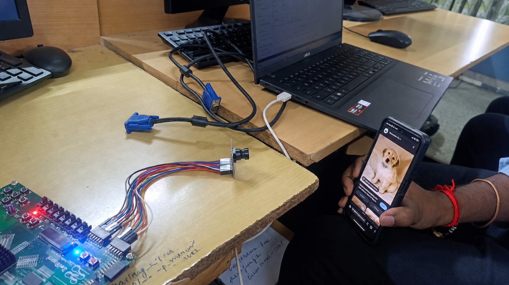
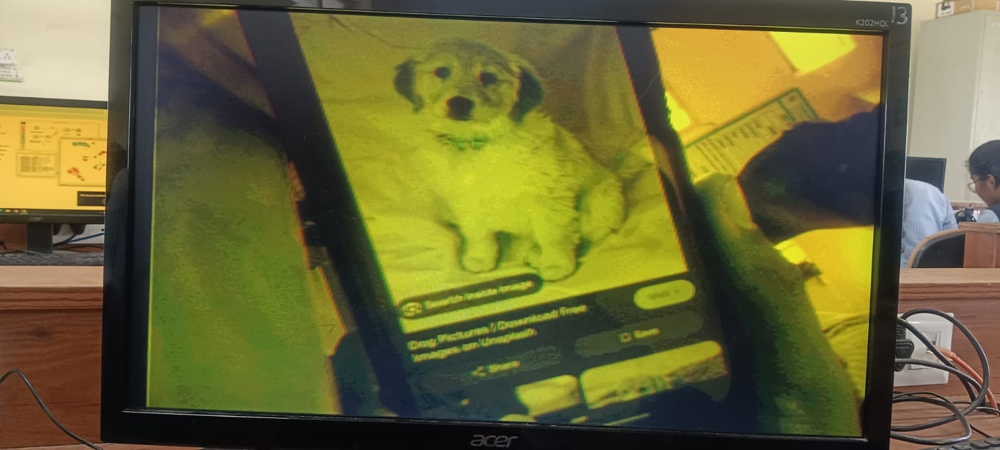
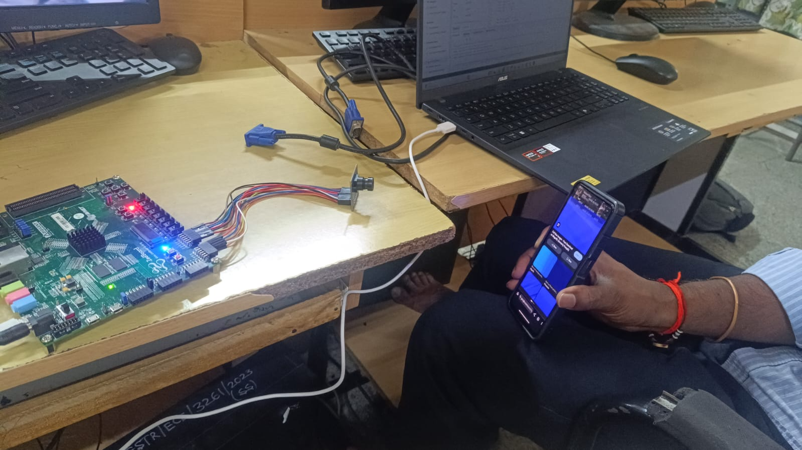
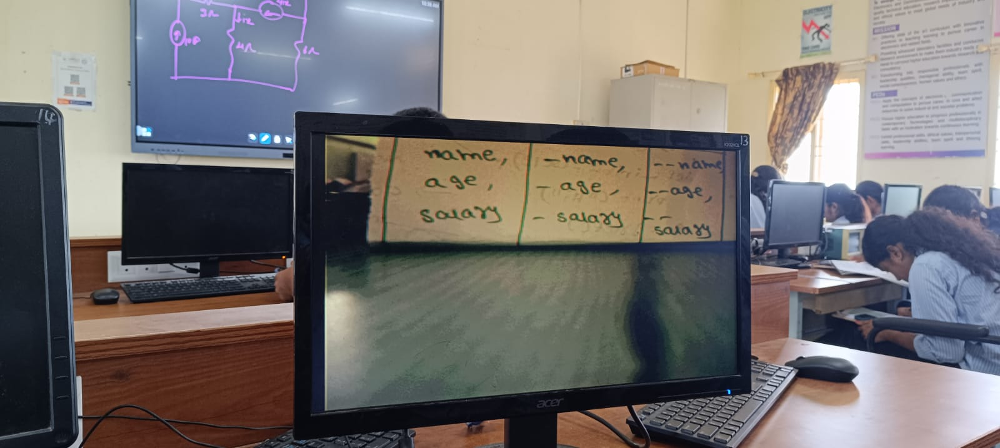
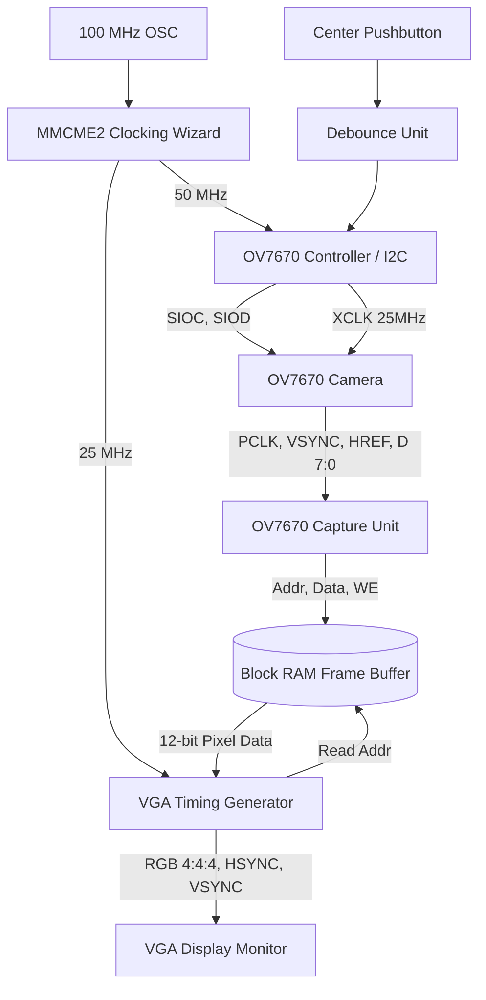

# 📷 OV7670 Camera to VGA Interface on Xilinx ZedBoard (Zynq-7000)


-orange.svg)


A complete **Verilog hardware implementation** that captures real-time video from an **OV7670 camera module** and displays it live on a **VGA monitor**, running entirely on a Xilinx ZedBoard (Zynq-7000 FPGA).

There is **no CPU core, no MicroBlaze, and no OS** involved — the entire pipeline (camera configuration, pixel capture, frame buffering, and VGA output) is custom FPGA logic.

---

## 🧭 What This Project Does (Input → Output)

In one sentence: **whatever the OV7670 camera is pointed at, appears live on the VGA monitor**, refreshed continuously at 60 Hz.

| Stage | What Goes In | What Comes Out |
| :--- | :--- | :--- |
| **1. Input** | Live optical image seen by the OV7670 camera lens (e.g. a face, a printed photo, a phone screen) | 8-bit parallel pixel data (`OV7670_D[7:0]`) + `PCLK`, `HREF`, `VSYNC` timing signals |
| **2. Capture** | Raw byte-pair pixel stream from the camera | 12-bit RGB444 pixel values written into the frame buffer |
| **3. Storage** | 12-bit pixel + write address from the capture stage | One full 640×480 frame held in Block RAM (dual-clock, so writing and reading never collide) |
| **4. Output** | Stored frame read out at 25 MHz | Standard VGA signal (`HSYNC`, `VSYNC`, 4-bit R/G/B) driving a monitor at 640×480 @ 60 Hz |

**Example from actual hardware testing (see `docs/` photos):**
- **Input**: A phone showing a photo of a puppy was held up in front of the OV7670 lens.
- **Output**: The VGA monitor displayed the live camera feed of that phone screen in real time, proving the full capture → buffer → display pipeline works end-to-end on hardware (no simulation).

---

## 🌟 Demo

### Example 1 — Phone Screen (Puppy Photo)

| Camera + Board Setup (Input Side) | VGA Monitor Output (Live Feed) |
| :---: | :---: |
|  |  |

*(ZedBoard connected to the OV7670 camera via jumper wires, VGA cable running to a monitor. A phone displaying a puppy photo was held in front of the camera; the right-hand photo shows the monitor displaying that live feed.)*

### Example 2 — Handwritten Notes on Paper

| Camera + Board Setup (Input Side) | VGA Monitor Output (Live Feed) |
| :---: | :---: |
|  |  |

*(Same setup — ZedBoard, OV7670 camera, VGA cable to monitor. This time the camera was pointed at a handwritten note (columns labeled `name`, `age`, `salary`), and the VGA output shows the live capture of the page, confirming the pipeline reproduces fine text detail, not just blocks of color.)*

---

## 🚀 Key Features

- **Pure Verilog Hardware Architecture** — zero software overhead, direct hardware pipeline, minimal latency.
- **Hardware I2C / SCCB Controller** — automatically configures the OV7670's internal registers (AGC, AWB, RGB output mode, scaling) on power-up or button reset, with no host CPU needed.
- **Byte Stream → 12-bit RGB Capture** — extracts pixel byte pairs from the camera bus and converts them into 12-bit RGB (RGB444) video data.
- **Dual-Clock Frame Buffer (BRAM)** — Xilinx Block RAM (`blk_mem_gen_0`) with decoupled write (camera `PCLK`) and read (VGA 25 MHz) clock domains, so capture and display never interfere with each other.
- **Standard VGA 640×480 @ 60 Hz Timing Generator** — produces precise horizontal/vertical sync and drives the board's R/G/B DAC resistor ladder.
- **Debounced Configuration Reset** — press a single board pushbutton to re-trigger camera I2C initialization if the picture looks wrong on startup.

---

## 📐 System Architecture (Signal Flow)



---

## 🧩 Bill of Materials (Physical Inputs to the System)

| Item | Purpose |
| :--- | :--- |
| Xilinx ZedBoard (XC7Z020, part `xc7z020clg484-1`) | The FPGA board running all the logic |
| OV7670 camera module (no FIFO version) | Video input source |
| Jumper wires (male-to-female, ~10) | Connects OV7670 to ZedBoard Pmod/GPIO pins |
| VGA cable | Carries the video output to a monitor |
| VGA-capable monitor | Displays the live feed (this is your "output device") |
| Micro-USB cable | Programming/JTAG connection from PC to ZedBoard |
| 5V power supply for ZedBoard | Powers the board |

---

## 🔌 Hardware Pin Mapping (ZedBoard)

### 1. OV7670 Camera Interface — **Inputs to the FPGA from the camera**

| Signal Name | FPGA Pin | IO Standard | Direction | Description |
| :--- | :--- | :--- | :--- | :--- |
| `OV7670_PWDN` | `Y11` | LVTTL | FPGA → Camera | Power Down Control |
| `OV7670_RESET` | `AB11` | LVTTL | FPGA → Camera | Camera Active-Low Reset |
| `OV7670_D[0]` | `AA11` | LVTTL | Camera → FPGA | Pixel Data Bit 0 |
| `OV7670_D[1]` | `AB10` | LVTTL | Camera → FPGA | Pixel Data Bit 1 |
| `OV7670_D[2]` | `Y10` | LVTTL | Camera → FPGA | Pixel Data Bit 2 |
| `OV7670_D[3]` | `AB9` | LVTTL | Camera → FPGA | Pixel Data Bit 3 |
| `OV7670_D[4]` | `AA9` | LVTTL | Camera → FPGA | Pixel Data Bit 4 |
| `OV7670_D[5]` | `AA8` | LVTTL | Camera → FPGA | Pixel Data Bit 5 |
| `OV7670_D[6]` | `W12` | LVTTL | Camera → FPGA | Pixel Data Bit 6 |
| `OV7670_D[7]` | `V12` | LVTTL | Camera → FPGA | Pixel Data Bit 7 |
| `OV7670_XCLK` | `W11` | LVTTL | FPGA → Camera | System clock output to camera (25 MHz) |
| `OV7670_PCLK` | `W10` | LVTTL | Camera → FPGA | Pixel clock input from camera |
| `OV7670_HREF` | `V10` | LVTTL | Camera → FPGA | Horizontal reference input |
| `OV7670_VSYNC` | `V9` | LVTTL | Camera → FPGA | Vertical sync input |
| `OV7670_SIOD` | `W8` | LVTTL | Bidirectional | SCCB Data (I2C SIOD) |
| `OV7670_SIOC` | `V8` | LVTTL | FPGA → Camera | SCCB Clock (I2C SIOC) |

### 2. VGA Output Pins — **Outputs from the FPGA to the monitor**

| Signal Name | FPGA Pin | IO Standard | Description |
| :--- | :--- | :--- | :--- |
| `vga_red[0..3]` | `V20, U20, V19, V18` | LVCMOS33 | Red channel (4-bit DAC) |
| `vga_green[0..3]` | `AB22, AA22, AB21, AA21` | LVCMOS33 | Green channel (4-bit DAC) |
| `vga_blue[0..3]` | `Y21, Y20, AB20, AB19` | LVCMOS33 | Blue channel (4-bit DAC) |
| `vga_hsync` | `AA19` | LVCMOS33 | Horizontal sync pulse |
| `vga_vsync` | `Y19` | LVCMOS33 | Vertical sync pulse |

### 3. System & Status Pins

| Signal Name | FPGA Pin | IO Standard | Description |
| :--- | :--- | :--- | :--- |
| `clk100` | `Y9` | LVCMOS33 | 100 MHz on-board clock oscillator (system input) |
| `btn` | `T18` | LVTTL | Center pushbutton — re-send I2C config (manual input) |
| `LED[0]` | `T22` | LVTTL | Configuration-finished indicator (status output) |
| `LED[1..7]` | `T21, U22, U21, V22, W22, U19, U14` | LVTTL | Reserved / status LEDs |

---

## 🛠️ Step-by-Step: Build and Run in Vivado

### Step 1 — Wire Up the Hardware
1. Connect the OV7670 camera module to the ZedBoard using jumper wires, following the **pin mapping table above** (Section 1).
2. Connect a VGA cable from the ZedBoard's VGA port to your monitor.
3. Connect the ZedBoard to your PC with the micro-USB programming cable.
4. **Do not power on yet** — power on only after the bitstream is loaded, or after you're ready to program.

### Step 2 — Create a New Vivado Project
1. Open **Xilinx Vivado** (2020.1 or newer).
2. Click **Create Project** → give it a name and location.
3. Choose **RTL Project** (do *not* specify sources at this step).
4. Select board: **ZedBoard**, part `xc7z020clg484-1`.

### Step 3 — Add Source Files
1. Add every Verilog file from `rtl/` to the project:
   - `ov7670_top.v`, `vga.v`, `ov7670_capture.v`, `ov7670_controller.v`, `ov7670_registers.v`, `i2c_sender.v`, `debounce.v`, `clocking.v`
2. Set `ov7670_top.v` as the **Top Module**.
3. Add `constraints/zedboard_ov7670.xdc` under **Constraints**.

### Step 4 — Generate the Block RAM IP (`blk_mem_gen_0`)
This IP core is **not included in the repo** — Vivado generates it locally, and it's required for the frame buffer to exist.
1. Open **IP Catalog** → search **Block Memory Generator**.
2. Configure:
   - **Component Name**: `blk_mem_gen_0`
   - **Memory Type**: `Simple Dual Port RAM`
   - **Port A (Write)**: Width = `12`, Depth = `307200` (or Address Width = `19`)
   - **Port B (Read)**: Width = `12`, Depth = `307200`
   - **Enable Port Type**: `Always Enabled`
3. Click **Generate Output Products**.

### Step 5 — Synthesize, Implement, and Program
1. Run **Synthesis** (`Ctrl+Shift+R`).
2. Run **Implementation** (`Ctrl+Shift+I`).
3. Click **Generate Bitstream**.
4. Power on the ZedBoard, open **Hardware Manager**, and click **Program Device**.

### Step 6 — Verify the Output
1. Once programmed, `LED[0]` should turn on — this confirms the camera's I2C configuration sequence completed successfully.
2. The VGA monitor should now show a **live image of whatever the OV7670 lens is pointed at**.
3. If the picture is blank, frozen, or discolored, press the **center pushbutton** (`btn`) to re-send the camera configuration — see Troubleshooting below.

---

## 📊 Synthesis & Implementation Metrics (Vivado, Post-Implementation)

The design is extremely lightweight, leaving well over 99% of FPGA logic free for downstream image processing (edge detection, thresholding, ML inference, etc.).

| Resource | Used | Available | Utilization % |
| :--- | :---: | :---: | :---: |
| **LUT** | 431 | 53,200 | 0.81 % |
| **FF (Flip-Flops)** | 266 | 106,400 | 0.25 % |
| **BRAM** | 75 | 140 | 53.57 % |
| **IO Pins** | 39 | 200 | 19.50 % |
| **BUFG** | 4 | 32 | 12.50 % |
| **MMCM** | 1 | 4 | 25.00 % |

> ⚠️ **Power report caveat**: If your own Power report shows an alarmingly high on-chip power / junction-temperature warning, this is almost always a **vectorless power estimate with no clock constraints defined**, not a real hardware issue — see Troubleshooting.

---

## 📁 Repository Structure

```text
ov7670-zedboard-vga/
├── rtl/
│   ├── ov7670_top.v        # Top-level Verilog wrapper
│   ├── vga.v               # VGA 640x480 @ 60Hz timing & color generator
│   ├── ov7670_capture.v    # Pixel byte capture & RGB extractor
│   ├── ov7670_controller.v # Camera controller top
│   ├── ov7670_registers.v  # SCCB configuration memory matrix
│   ├── i2c_sender.v        # I2C / SCCB bit-bang master protocol
│   ├── debounce.v          # Pushbutton noise filter logic
│   └── clocking.v          # MMCME2 clock synthesizer (100MHz -> 50MHz/25MHz)
├── constraints/
│   └── zedboard_ov7670.xdc # Vivado pin assignment & timing constraints
├── docs/
│   ├── hardware-setup.png  # Photo: camera + ZedBoard wiring (input side)
│   └── vga-output.png      # Photo: live VGA monitor output
├── LICENSE
├── .gitignore
└── README.md
```

---

## 💡 Troubleshooting & Notes

- **Blank or discolored screen on startup** → Press the center pushbutton (`btn` / `T18`) to re-trigger the SCCB register configuration sequence.
- **`CLOCK_DEDICATED_ROUTE` warning** → `OV7670_PCLK` enters through a standard FPGA I/O pin, not a dedicated clock pin. The XDC includes `set_property CLOCK_DEDICATED_ROUTE FALSE [get_nets OV7670_PCLK_IBUF]` so it can still route through the internal BUFG network. This is expected and not an error.
- **Power report shows an extreme junction-temperature warning** → This happens when Vivado has no explicit clock constraints (`create_clock`) for `clk100` or `OV7670_PCLK`, so it falls back to pessimistic default toggle-rate estimates (report will also show "Confidence level: Low"). Add proper clock constraints to the `.xdc` and re-implement to get a realistic, low sub-1W estimate.
- **`blk_mem_gen_0` not found during synthesis** → You skipped Step 4. This IP is generated locally per-project and is intentionally not checked into the repo.

---

## 📄 License

Distributed under the **MIT License**. Feel free to modify and adapt for academic research or embedded vision projects!
